# Лаба 4 — репликация PostgreSQL: поднять, сломать, восстановить

В этой лабе небоходимо было

## Часть 0. Выбран PostgreSQL

Для работы был выбран Postgress, во-первых потому что он родной и знакомы, во-вторых потому что тут streaming replication настраивается декларативно через
конфигурационные файлы и failover выполняется вручную — это позволяет на каждом шаге
увидеть, что именно происходит с WAL, standby и клиентскими подключениями.

## Часть 1. Поднимем репликацию

В этой части была создана структура всего проекта и написан докер компоуз.

Структура:

lab4/
├── docker-compose.yml
├── primary/
│   └── init-primary.sh
├── replica/
│   └── init-replica.sh
├── app/
│   ├── Dockerfile
│   ├── package.json
│   └── server.js
├── monitoring/
│   ├── prometheus.yml
│   └── docker-compose.monitoring.yml
└── report.md

В докеркомпоузе прописали два сервиса для Postgres (pg-primary, pg-standby)

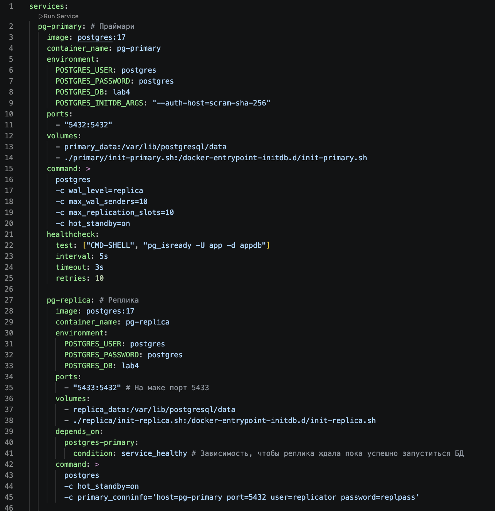

Для обоих сервисов были созданы volumes и указаны директории для хранения данных, настроены порты, указан путь к скриптам инициализации и написаны команды, которые без редактирования переопределяют некоторые значения файла postgresql.conf (включение реплики, задание числа процессов, которые могут отправлять WAL standby-серверам, разрешение читать с standby). Для БД был добавлен healthcheck.

По итогу получается два сервера базы. Праймари на порту 5432, реплика - на 5433.

После этого написаны были скрипты инициализации для обоих сервисов постгрес.

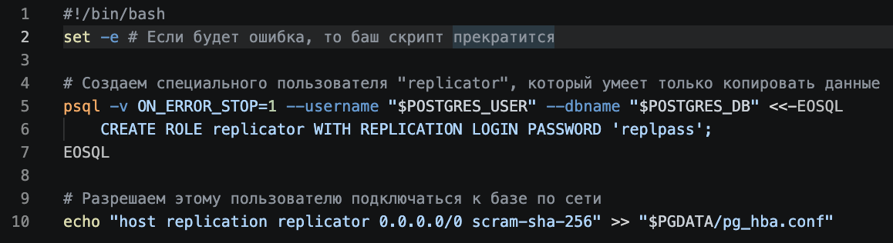

Тут подключаемся к БД от имени главного пользователя и выполняем квери создания пользователя replicator (WITH REPLICATION значит что он имеет право скачивать WAL) и задаем ему пароль. И потом в конец файла pg_hba.conf добавили что этому пользователю можно подключаться к БД по сети.

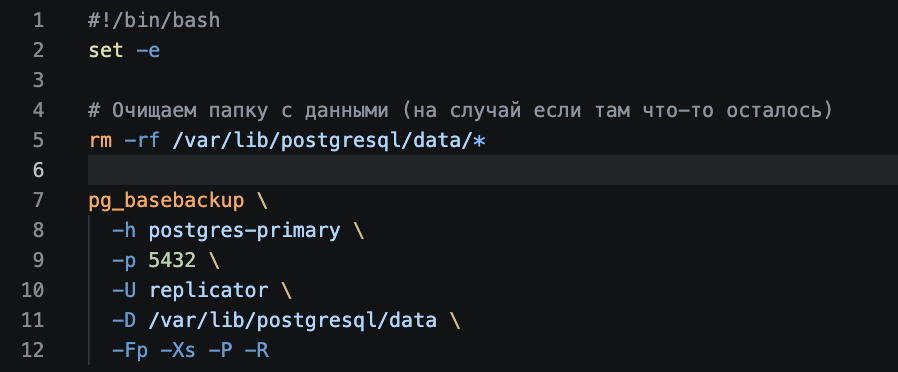

Для копирования надо чтобы папка с данными была пустая, поэтому очищаем ее. Потом используем утилиту pg_basebackup: с хоста который праймари контейнер на порте 5432 юзером replicator из директории с данными копируем бдшку. Флаги означают: Fp (format plain) - сохраняем не архивами а файлами, Xs (external stream) - стримим новые изменения во время копирования, чтобы данные актуальные были, P (Progress) - прогресс бар в консоли, R (Recovery) - создает файл standby.signal и при запуске Posthres понимает, что он просто копия и в конфиге прописывает строку подключения к главной БД. Без последнего флага была бы создана просто новая пустая БД.

## Часть 2. Сервис

Далее был навайбкожен сервис на питоне. В приложении мы берем адреса реплики и праймари, ставим счетчики для мониторинга, создаем словари с рандомными словами для записей, подключаемся к бдшке, потом создаем таблицу для наших записей. Дальше там функции добавления одной записи, сбора статистики с праймари и реплики. После этого идут прописанные фастапи эндпоинты для метрики, пост метод для добавления записи, пост метод для нагрузки (для дальнейших пунктов), главная страница (в этом эндпоинте собираются метрики и создается html страница).

Также написали в папке app докерфайл который запускает сервис на ювикорне и добавили requrements.txt. В компоузе была прописана инициализация контейнера с сервисом.

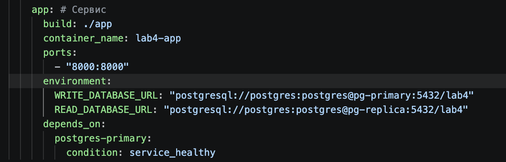

Билдим с папки app, назначили порт 3000, указали переменные для БД и поставили зависимость от сервиса праймари.

## Часть 3. Поймай replication lag если сможешь

Решив пару (час приятных бесед с дипсиком) проблем, все контейнеры были успешно подняты.

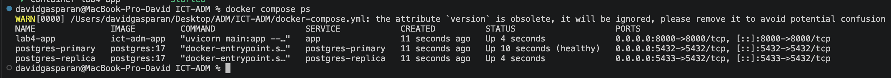

Все живы все работают. Дальше открыли главную страницу, видим что подключены к праймари и реплике.

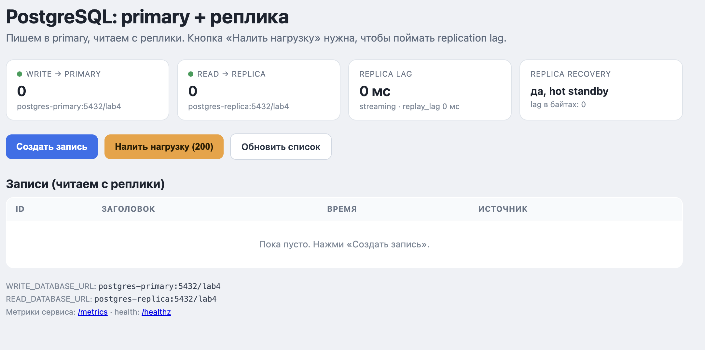

Нажимаем налить нагрузку и видим, что никакого лага нет. Так получилось что реплика читала все одновременно. Была выполнена команда через терминал которая вставила 10000 записей. Разницу между кол-вом запией не получилось поймать но счетчик лага реплики выдал 2 мс.

Концепция лага реплики была усвоена: Если праймари с репликой находятся на разных серверах и нагрузка еще больше, то и отставание становится явнее. Поцмать его локально было сложно, тк локальная сеть быстрее.
Чем грозит: В реальной системе этот лаг может достигать секунд. Клиент который только что сохранил данные в праймари при чтении с реплики может их не увидеть (нарушение read-your-writes).
Как измеряется: В СУБД PostgreSQL лаг измеряется через системное представление pg_stat_replication (разница между текущей позицией WAL на primary и позицией, примененной на реплике, — pg_wal_lsn_diff).

## Часть 4. Теорема CAP

Наша архитектура с асинхронной репликацией тяготеет к модели AP (Availability + Partition Tolerance) — доступность и устойчивость к разделению. То есть мы жертвуем строгой согласованностью, так как разрешаем чтение устаревших данных с реплики (отсюда и наш микролаг). Чтобы сместиться в сторону С, нужно включить синхронную репликацию и тогда primary будет ждать подтверждения от реплики перед коммитом. Однако в CAP можно выбрать только две части, поэтому с синхронной репликацией мы пожертвуем скоростью. И если праймари упадет то реплика перестанет отвечать (потеряем А).

## Часть 5. Ручной Failover

Тут мы как раз и проверили как у нас работает устойчивость. Был остановлен контейнер с праймари через терминал 

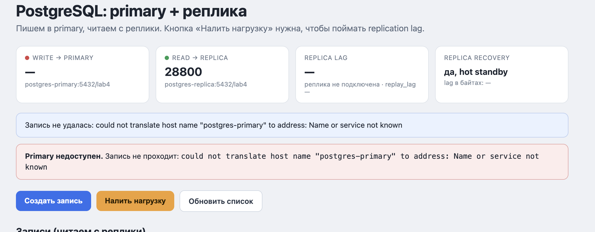

Как видно, запись добавить не получается и выдает красную плашку. При этом к реплике доступ имеем и записи читаем. После этого через терминал вручную сделали промоут

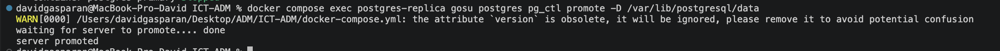

Эта команда делает промут с пользователя postgres использую утилиту pg_ctl. Потом в компоузе был переписан URL для базы записи (поставили тоже реплику) и перезапустили только контейнер с сервисом.

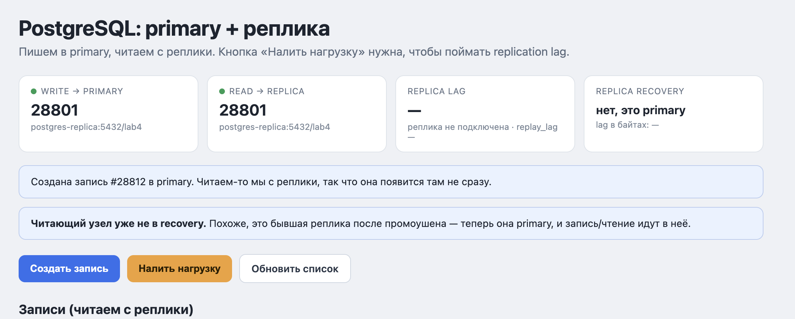

Как видим пишет что читающий узел теперь реплика и теперь она праймари.
## Часть 6. Мониторинг

После этого был настроен мониторинг. Написали prometheus.yml и docker-compose.monitoring.yml.

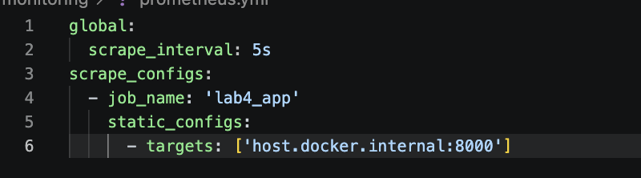

Тут говорим что каждые пять секунд он будет собирать данные через порт 8000 (наше приложение).

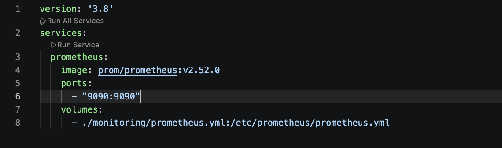

Здесь создаем контейнер с Prometheus на порте 9090 и подключаем том в который монтируем yml файл. Поднимаем этот контейнер и заходим по адресу localhost:9090.

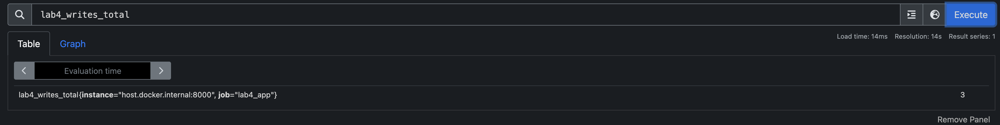

Одна из полученных метрик -общее число записей. Prometheus у нас собирает данные с эндпоинта /metrics. Для алертов выбрали бы: _`lab4_write_errors_total`_ - количество ошибок и если счетчик растет, то упал праймари, _`lab4_writes_total`_ - резкий рост может указывать на аномалию или на то, что реплика не справляется, _`replica lag`_ - если лаг больше 10 секунд значит реплика зависла или сеть перегружена. Грозит тем, что пользователи читают устаревшие данные.
